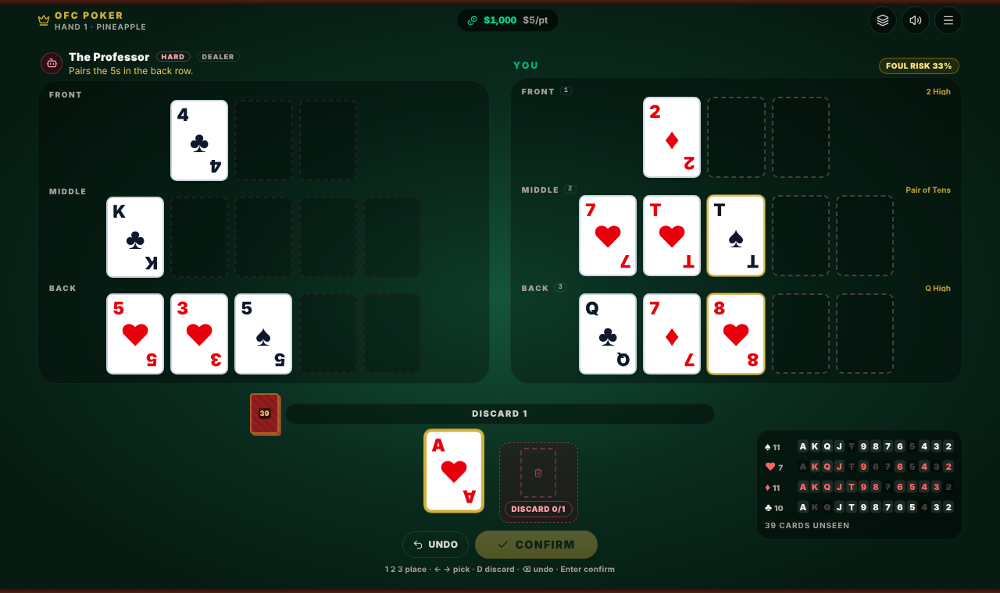
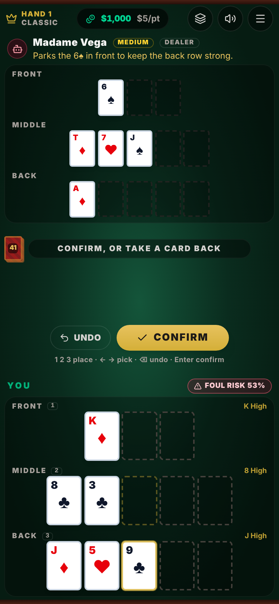
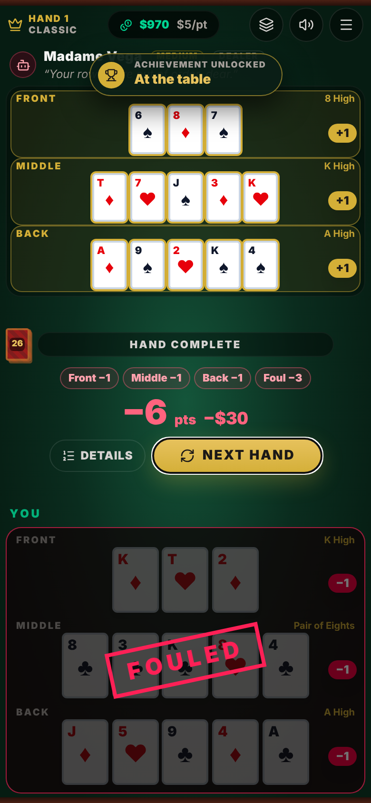
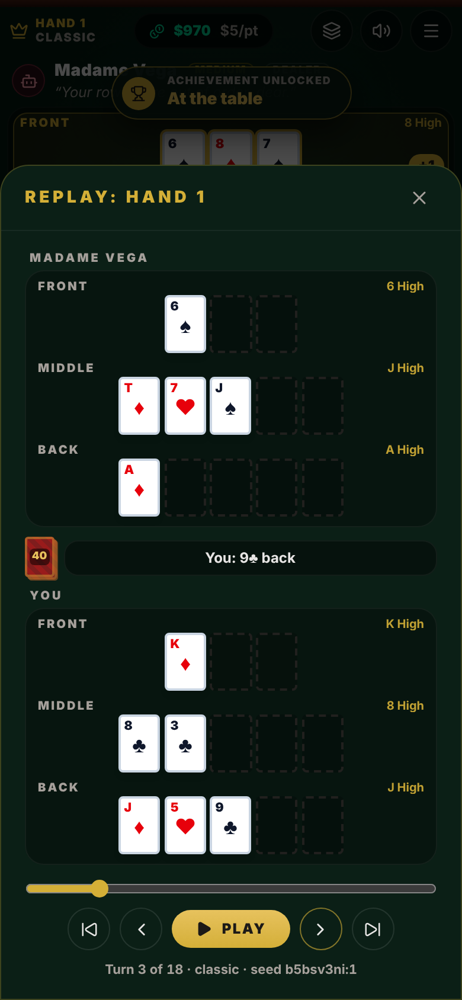

# OFC Poker

Single-player **Open Face Chinese Poker** against a CPU opponent. React 18 + TypeScript + Vite + Tailwind CSS v4, deployed to Cloudflare with `wrangler`.

Play Classic or Pineapple Open Face Chinese Poker against a CPU with three difficulty levels, with royalties, Fantasyland, hand replay, a tutorial and offline support.

| Table (desktop) | Phone | Result | Replay |
|---|---|---|---|
|  |  |  |  |


## Run, test, deploy

```bash
npm install
npm run dev          # local dev server
npm test             # Vitest unit tests (engine, AI, state)
npm run typecheck    # tsc --noEmit (strict)
npm run build        # typecheck + production build into dist/
npm run deploy       # typecheck + build, then `wrangler deploy` (run `npx wrangler login` once first)
```

## How the game is built

```
src/
  engine/      Pure, typed game engine. No React, no DOM, no timers, no Math.random.
    evaluate   row evaluation + comparison (wheel, kickers, 3-card front)
    foul       foul detection
    royalties  royalty tables, Fantasyland entry / stay rules
    scoring    full-hand scoring (rows, scoop, foul, royalties)
    reducer    the state machine: dealing, turns, staging/undo, scoring
    rng, deck  seeded shuffling (same seed = same deal)
    session    bankroll, dealer button, Fantasyland carry-over
  ai/          CPU opponent: heuristic, Monte Carlo search, Fantasyland solver, personas.
               Runs in a Web Worker; sees only what a player may see.
  state/       App reducer, lifetime stats, achievements, save/load, and the hook that owns the CPU's timers
  ui/          Presentation infrastructure: card flights, pointer drag, keyboard,
               sound, score reveal, preferences, foul-risk helper
  components/  Rendering only; they dispatch actions
tests/         Vitest suites for everything above
```

The engine is a reducer: `gameReducer(state, action) -> state`. Illegal actions return the *same* state object, so double clicks and late timers are harmless. Every applied action is logged, and `replay(log)` rebuilds a hand exactly. Cards are only ever dealt inside the reducer, so a card can never be dealt twice.

## Playing

### Controls

| Input    | How                                                                                               |
|----------|---------------------------------------------------------------------------------------------------|
| Tap      | Tap a card, then tap a row. With one card left in hand it is selected for you.                    |
| Drag     | Drag a card to a row, to the discard zone, or back to your hand. Works with mouse, finger or pen. |
| Keyboard | `1` `2` `3` place on front / middle / back · `←` `→` pick a card · `D` discard · `Backspace` undo · `Enter` confirm, skip the score reveal, or deal the next hand · `Esc` clear selection |

Cards you place stay movable until you press **Confirm**: tap one to take it back, drag it to another row, or use **Undo**.

### Helpers (each can be switched off in Settings)

* **Hand names:** what each row currently makes.
* **Foul warning:** an estimated chance your board ends up fouled, from simulated play-outs of the rest of the hand, plus a red "Foul certain" as soon as no remaining card can save it.
* **Outs:** live cards that complete a row with one slot left ("Flush 7 outs"), and two-card flush draws. Dead cards are excluded.
* **Royalty preview:** royalties already locked in.
* **Cards remaining:** every card in the deck with the dead ones crossed out, and live counts per suit. Opens from the header; always visible on wide screens.
* **CPU move reasons:** a one-line explanation of some of the CPU's moves.

### Feel

* Cards fly from the deck and flip as they are dealt, glide between hand and board, and the opponent's Fantasyland board flips over at showdown.
* Scoring is revealed row by row with a running total that counts up; press **Skip** (or `Enter`) to jump to the end.
* Sound effects are synthesised in the browser (no audio files). Mute from the header. Phones that support it give a light vibration.
* Animation speed: Normal, Fast or Off.

### Accessibility

* Optional **four-colour deck** (clubs green, diamonds blue); suits are always shown as shapes as well as colours.
* The operating system's **reduce motion** setting is respected: no card flights, flips or count-ups, and the score appears at once.
* Fully playable from the keyboard. Cards, rows, slots and dialogs have screen-reader labels, and status changes are announced.
* Checked with axe-core (WCAG 2 A/AA rules) on the start screen, the table, and the dialogs: no violations.

### Layout

No horizontal scrolling at any size. In portrait the opponent is on top and your board at the bottom; in landscape the boards sit side by side with your hand underneath. Card size follows both the width and the height of the screen, so the whole table fits on one screen from about 390×800 upward. Smaller or very short screens (for example 375×667, or a phone held sideways) scroll vertically.

## Progress, saving and installing

* **Autosave** (localStorage, this device only): bankroll, settings, preferences, lifetime stats, achievements, the last 50 hands, and the hand in progress, which resumes after a refresh. A hand is saved as its seed plus its action log and rebuilt by replaying it through the engine; the engine ignores illegal actions, and saved data is validated field by field, so a damaged or hand-edited save loses data at worst and cannot crash the game. If the CPU was mid-turn, it simply decides that turn again. Settings has "Erase all data".
* **Stats:** hands played, win / foul / Fantasyland rates, biggest win, royalties earned, net points, scoops, best no-foul streak.
* **Hand history and replay:** open any of the last 50 hands from Menu, History and step through it turn by turn (scrubber, play/pause, arrow keys). It shows everything, including a Fantasyland board that was hidden at the time.
* **Rules and royalties** reference (Menu): the royalty tables are read from the engine, so they cannot drift from what the game pays.
* **Guided first hand:** an optional walkthrough on your first deal (and from the menu any time). It never blocks play: steps that teach an action wait for you to do it.
* **Achievements:** 18, from "first scoop" and "first Fantasyland" to a 10-hand no-foul streak, shown as a toast when unlocked.
* **Settings:** variant, CPU level, stake, Fantasyland mode, deck style (four-colour, card-back colour), animation speed, sound, vibration, every helper.
* **Installable PWA that works offline:** a service worker generated at build time precaches the exact files of that build (including the CPU's worker), serves pages network-first so online players get updates, and falls back to the cache offline. Use the browser's install button or Menu, Install app (Chromium); on iOS use Share, Add to Home Screen.

## Rules

Each player builds three rows from 13 cards: **front** (3 cards), **middle** (5) and **back** (5). Cards are placed face up and can't be moved once confirmed. The back row must be at least as strong as the middle, and the middle at least as strong as the front, or the board **fouls**.

### Variants

| Variant   | Deal                                                      |
|-----------|-----------------------------------------------------------|
| Classic   | 5 cards, then 8 single cards, all placed                  |
| Pineapple | 5 cards, then 4 times: get 3, place 2, discard 1          |

Players alternate turns. The dealer button flips every hand, and the player after the button acts first on each street. Discards are dead cards that only their owner can see.

### Scoring (heads-up)

* **+1** per row won, **0** for a tied row.
* **Scoop:** winning all three rows adds **+3**.
* **Foul:** a fouled board loses a full scoop (**6 points**) to the opponent and earns **no royalties**. If both boards foul, nothing changes hands. The non-fouling player still collects their royalties.
* Payout = net points × stake per point. Your bankroll starts at $1,000 and can go negative.

### Royalties (standard American table)

| Row    | Hand                                                                                            | Points |
|--------|-------------------------------------------------------------------------------------------------|--------|
| Front  | Pair of 6s, 7s, 8s, 9s, 10s, Js, Qs, Ks, As                                                     | 1, 2, 3, 4, 5, 6, 7, 8, 9 |
| Front  | Three of a kind, 222 up to AAA                                                                  | 10 up to 22 |
| Middle | Trips / Straight / Flush / Full house / Quads / Straight flush / Royal flush                    | 2 / 4 / 8 / 12 / 20 / 30 / 50 |
| Back   | Straight / Flush / Full house / Quads / Straight flush / Royal flush                            | 2 / 4 / 6 / 10 / 15 / 25 |

The three-card front row can only make high card, pair or trips. The wheel (A-2-3-4-5) is the lowest straight. Suits never break ties.

### Fantasyland

* **Entry:** a non-fouling board with **QQ or better** in the front row.
* **Cards dealt:** configurable.
  * *14 cards* (flat), or
  * *Progressive*: QQ = 14, KK = 15, AA = 16, trips = 17.
* A Fantasyland player gets all their cards at once, places 13 and discards the rest. Their board stays face-down to the opponent until the hand is over.
* **Staying in:** play a non-fouling board with **front trips, a middle full house or better, or back quads or better**. In progressive mode a stay re-deals by the front hand again (14 if you stay through the middle or back row).
* Both players can be in Fantasyland in the same hand.

### Conventions where the rules are ambiguous

These follow the most common online-OFC behaviour:

* A front row that ties the top cards of the middle row is **not** a foul (e.g. A-K-Q front under A-K-Q-J-9 in the middle).
* A foul is a flat 6 points plus the opponent's royalties; the fouler's rows are not scored individually.
* Fantasyland royalties are paid like any other hand.
* The seed behind every deal is shown in the header and a hand can be replayed from it.

## The CPU opponent

Pick a level in the settings (before a hand, or between hands). Each level has its own name and personality, and can explain some of its moves ("Why" toggle above the CPU's board).

| Level  | Name          | How it plays                                                                                  |
|--------|---------------|-----------------------------------------------------------------------------------------------|
| Easy   | Lucky Lou     | One-step heuristic with random jitter. Makes mistakes.                                        |
| Medium | Madame Vega   | Monte Carlo over its 3 best placements, 12 simulated futures each.                            |
| Hard   | The Professor | Monte Carlo over up to 11 placements (including Fantasyland-seeking ones), 240 futures each.  |

**How the Monte Carlo search works** (`src/ai/montecarlo.ts`)

* It shortlists placements with the heuristic, then simulates random futures for each one. Only cards the CPU can't see are drawn: its own board, hand and discards, and everything visible on your board, are dead cards. Your hidden Pineapple discards are not known to it.
* Both players are completed with the heuristic as a stand-in playout policy, then scored exactly with the real rules. The value of a placement is the average of points, royalties, foul penalties and Fantasyland equity.
* Every placement faces the same simulated futures (common random numbers), and clearly losing placements are dropped halfway, so few simulations still rank placements reliably.
* Fantasyland hands (14-17 cards) are solved exactly by a dedicated royalty-maximising search.
* The thinking runs in a Web Worker (`src/ai/worker.ts`), started the moment the CPU's turn begins, with a short minimum delay so pacing feels natural. If workers are unavailable the same code runs on the main thread.

**Measured strength** (points per hand, with standard error; seats swapped; `scripts/bench-ai.ts`):

| Match                    | Classic        | Pineapple      |
|--------------------------|----------------|----------------|
| Medium vs Easy           | +2.5 (0.36)    | +2.3 (0.71)    |
| Hard vs Medium           | +1.0 (0.44)    | not measured   |
| Hard vs Easy             | +3.4 (0.65)    | +7.1 (0.81)    |

| Fouls per hand | Classic  | Pineapple |
|----------------|----------|-----------|
| Easy           | 33-40%   | 16-18%    |
| Medium         | 12-21%   | about 6%  |
| Hard           | 7-12%    | about 2%  |

Fantasyland shows up mainly in Pineapple (Hard reaches it in about 7-8% of hands). In Classic, the gap between Medium and Hard is modest because the playout policy, not the number of simulations, limits strength there.

To reproduce:

```bash
npx vite-node scripts/bench-ai.ts hard medium 12 10 classic   # A B sessions handsPerSession variant
PARAMS_A='{"sims":60}' npx vite-node scripts/bench-ai.ts medium easy 20 10   # override sim settings
```

## Roadmap

1. ✅ **Foundation and correctness:** pure engine, real OFC rules, Pineapple, Fantasyland, tests, clean tooling.
2. ✅ **Monte Carlo CPU:** three levels, Web Worker, names and personalities, optional move explanations.
3. ✅ **Game feel:** card flights and flips, row-by-row score reveal, tap / drag / keyboard input with undo, live helpers, synthesised sound, responsive layouts, accessibility.
4. ✅ **Progression:** settings, autosave with resume, lifetime stats, hand history and replay, tutorial, achievements, offline PWA.
5. ✅ **Polish and ship:** Lighthouse 100 / 100 / 100 / 100 (mobile and desktop), lazy-loaded dialogs, Wrangler 4, SPA fallback, screenshots.

## Performance and deployment

* **Lighthouse** (production build, headless Chromium, mobile profile): Performance 100, Accessibility 100, Best Practices 100, SEO 100; LCP 1.7 s, TBT 10 ms, CLS 0. Desktop: LCP 0.4 s.
* **Bundle:** about 82 KB gzipped for the first load (React, the engine, the UI). The dialogs (replay, stats, rules, settings) are a separate 9 KB chunk loaded on first use, and the CPU runs from its own 15 KB worker file. No animation or sound libraries: card motion uses the Web Animations API and sound is synthesised.
* **Deploy:** the app is a static site served by Cloudflare Workers Assets (`wrangler.json`, with single-page-app fallback). `npm run deploy` runs the typechecked build and then `wrangler deploy`. `npx wrangler deploy --dry-run` checks the packaging without logging in: it was verified to read all 14 files from `dist/`. A real deploy needs `npx wrangler login` (or `CLOUDFLARE_API_TOKEN`), which was not available while building this.
